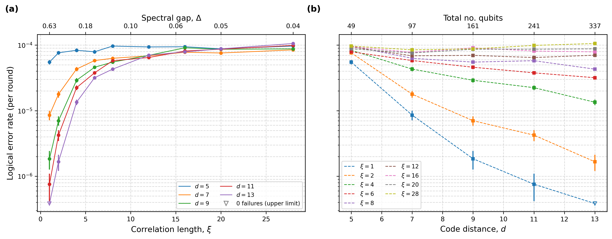
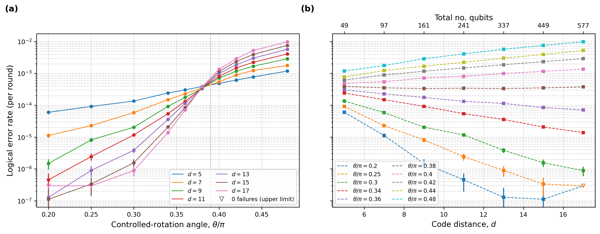

# Spatiotemporal Pauli Processes: surface-code memory under correlated noise

Stim/PyMatching replication of the surface-code memory experiments in
Kam et al., *Spatiotemporal Pauli Processes* ([arXiv:2603.05474](https://arxiv.org/abs/2603.05474)),
with the noise samplers cross-checked against exact process-tensor models.

Two correlated-noise models are applied to a rotated surface-code memory experiment
(distance `d`, `3d` rounds, baseline circuit noise `p = 0.001`) and decoded with minimum-weight
perfect matching:

| Model | Paper figure | Sweep (this repo) |
|---|---|---|
| **Temporal storm**: two-state hidden Markov noise per qubit, correlation length ξ, fixed marginal rate | Fig. 9 | d = 5-13, ξ = 1-28 |
| **QCA bath**: 2D quantum cellular automaton bath, controlled-rotation angle θ | Fig. 12 | d = 5-17, θ/π = 0.2-0.48 |

Each point uses 200,000 shots (the paper's storm sweep uses 10^7, so low-rate points here have larger error bars).

## Layout

```
noise/
  temporal_storm.py        two-state HMM noise source (one chain per qubit)
  automaton_bath.py        vectorised QCA bath (Pauli-twirled, exact PCA form)
  process_tensor.py        twirled process tensor (Pauli comb) from Kraus operators; exact + sampled
  qca_process_tensor.py    exact quantum model of the QCA bath for small lattices
decoding/
  matched_decoder.py       MWPM decoder matched to the noise marginal rate
experiments/
  memory_builder.py        base circuit + per-shot noise injection
scripts/
  run_temporal_storm_sweep.py
  run_automaton_sweep.py
  plot_results.py
validation/                cross-checks of the samplers (see below)
results/                   storm_sweep.json, automaton_sweep.json, figures/
```

## Install and run

```bash
pip install -r requirements.txt

python scripts/run_temporal_storm_sweep.py   # -> results/storm_sweep.json
python scripts/run_automaton_sweep.py        # -> results/automaton_sweep.json
python scripts/plot_results.py               # -> results/figures/*.png
```

Sweeps use all CPU cores but one, checkpoint atomically after every point, and resume
automatically if interrupted. Each script has a commented smoke-test block in `main()`.

## Results




- **Storm:** at fixed marginal rate, longer noise memory (larger ξ) raises the logical error rate and
  flattens the benefit of larger distance.
- **QCA:** curves for different distances cross near θ/π ≈ 0.38-0.39 (the paper's pseudo-threshold
  θ_th ≈ 0.39π). Below it, larger distance helps; above it, larger distance hurts. Low-θ points at
  large `d` have few failures and large error bars; zero-failure points are plotted as upper limits.

## Validation

`noise/process_tensor.py` and `noise/qca_process_tensor.py` are small independent implementations of
the twirled process tensor, used to check that the hand-written samplers describe the intended noise.
Run any of these from the repo root (`python validation/<file>`):

| Check | What it compares | Result |
|---|---|---|
| `validate_storm_pt.py` | `TemporalStorm` vs the storm as a process tensor (paper Eq. 77) vs an HMM forward calculation | exact match to 1e-16; samplers at sampling-noise level |
| `validate_decoder_pt.py` | the same two samplers through the same d=3 circuit and decoder | failure rates agree (|z| < 3) |
| `validate_automaton_pt.py` | `AutomatonBath` vs the exact quantum QCA (7-qubit lattice), one qubit's labels over 3 rounds | at sampling-noise level |
| `validate_automaton_kernel.py` | full one-round kernel of all 7 qubits, exact quantum model vs PCA rules | agree to 1e-16 |
| `validate_decoder_automaton_pt.py` | `AutomatonBath` vs the exact-model sampler through the d=2 decoder | failure rates agree (|z| < 3) |
| `validate_bath_density.py` | bath density and susceptibility vs the paper's Fig. 11 diagnostics | crossover and variance peak as in the paper |

The paper derives the QCA → PCA mapping analytically (App. C) and does not check it numerically; the
exact-model checks above are an independent numerical confirmation. The exact bath needs 2^n
dimensions, so the QCA checks are limited to the d=2 lattice. The update rule is local, so it applies
unchanged to larger lattices.

## Implementation notes and conventions

- **Noise injection.** Errors are injected as `X/Y/Z_ERROR(1.0)` per shot. Plain Pauli *gates* are
  absorbed into Stim's noiseless reference sample and produce no detection events.
- **Matched decoder.** The detector error model uses `DEPOLARIZE1(p_marg)` at the start of every
  round (including round 0), where `p_marg` is the long-run marginal error rate of the noise (exact
  for the storm, estimated from the simulated bath density for the QCA). The decoder is blind to
  correlations but not to rates.
- **QCA angle convention.** The bath's flip probability is `sin²(kθ/2)` for `k` excited neighbours.
  The paper's text (Eq. 85, App. C) writes `sin²(kθ)`, but its plotted θ axis and the authors' released
  sampler use the half angle. Our exact quantum model confirms that the half-angle convention
  corresponds to a rotation `exp(-i(θ/2)X)`, and it is the one that reproduces the paper's figures.
- **Differences from the authors' sampler.** (i) The marginal for the decoder is estimated by
  simulation here, and by a mean-field heuristic in the authors' code. (ii) The bath starts at
  all zeros (as in the paper's text); the authors' code draws it from the stationary storm
  distribution. (iii) Here the bath is updated once before the first emission; the authors emit
  round 0 from the initial state. All three should be minor at these settings.
- **Logical error rate.** Per-round rate from the per-shot failure probability:
  `p_round = (1 - (1 - 2 p_shot)^(1/N_r)) / 2`.
- **Reproducibility.** Each chunk of shots gets an independent RNG stream from
  `SeedSequence.spawn`. Seeds are not fixed, so reruns differ within statistical error.

## Known limitations

- The matched decoder uses the stationary marginal; the shot-averaged density above threshold can
  differ slightly.
- MWPM is not correlation-aware, as in the paper. This isolates the effect of noise memory on a
  standard decoder.
- 200,000 shots per point (the paper uses 10^7 for the storm sweep).