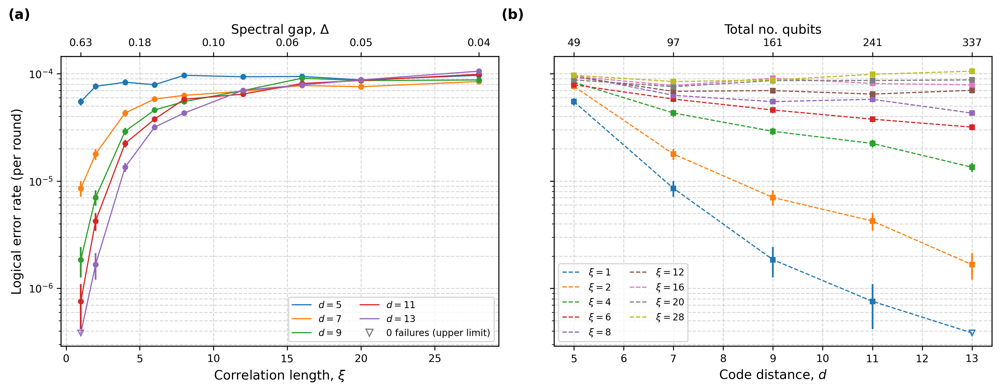
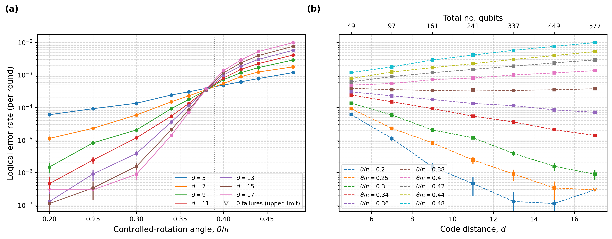

# Spatiotemporal Pauli Processes: surface-code memory under correlated noise

Stim/PyMatching replication of the surface-code memory experiments in
Kam et al., *Spatiotemporal Pauli Processes* ([arXiv:2603.05474](https://arxiv.org/abs/2603.05474)).

Two correlated-noise models are applied to a rotated surface code memory
experiment (distance `d`, `3d` rounds, baseline circuit noise `p = 0.001`) and
decoded with minimum-weight perfect matching:

| Model | Paper figure | Sweep |
|---|---|---|
| **Temporal storm**: 2-state hidden Markov noise with correlation length ξ and fixed marginal rate | Fig. 9 | d = 5-13, ξ = 1-28 |
| **QCA bath**: 2D quantum cellular automaton environment with controlled-rotation angle θ | Fig. 12 | d = 5-17, θ/π = 0.2-0.48 |

Each point uses 200,000 shots.

## Layout

```
noise/
  temporal_storm.py      two-state HMM noise source
  automaton_bath.py      vectorised QCA bath (Pauli-twirled, exact PCA form)
decoding/
  matched_decoder.py     MWPM decoder matched to the noise marginal rate
experiments/
  memory_builder.py      base circuit + per-shot noise injection
  run_temporal_storm_sweep.py
  run_automaton_sweep.py
  plot_results.py
results/                 storm_sweep.json, automaton_sweep.json, figures/
```

## Install and run

```bash
pip install -r requirements.txt

python experiments/run_temporal_storm_sweep.py   # -> results/storm_sweep.json
python experiments/run_automaton_sweep.py        # -> results/automaton_sweep.json
python experiments/plot_results.py               # -> results/figures/*.png
```

Sweeps use all CPU cores but one, checkpoint atomically after every point, and
resume automatically if interrupted. Each script has a commented smoke-test
block in `main()` for a quick check.

## Implementation notes

- **Noise injection.** Errors are injected as `X/Y/Z_ERROR(1.0)` per shot. Plain
  Pauli *gates* are absorbed into Stim's noiseless reference sample and produce
  no detection events.
- **Matched decoder.** The decoder's detector error model uses
  `DEPOLARIZE1(p_marg)` each round, where `p_marg` is the long-run marginal
  error rate of the noise (exact for the storm, estimated from the bath
  density for the QCA). It is blind to correlations but not to rates.
- **QCA convention.** The bath's flip probability is `sin^2(kθ/2)`. This
  half-angle convention reproduces the paper's plotted θ axis (crossover near
  θ/π ≈ 0.39).
- **Logical error rate.** Per-round rate from the per-shot failure
  probability: `p_round = (1 - (1 - 2 p_shot)^(1/N_r)) / 2`. Points with zero
  failures are plotted as upper limits (rule of three).
- **Reproducibility.** Each chunk of shots gets an independent RNG stream from
  `SeedSequence.spawn`. Seeds are not fixed, so reruns differ within
  statistical error.

## Results




The QCA sweep reproduces the paper's pseudo-threshold: curves for different
distances cross near θ/π ≈ 0.38-0.39, with larger distance helping below it
and hurting above it. Low-θ points at large `d` have few failures and large
error bars.

## Known limitations

- The matched decoder uses the stationary marginal; the shot-averaged density
  above threshold can differ slightly.
- The decoder is not correlation-aware, as in the paper. This isolates the
  effect of noise memory on a standard decoder.
